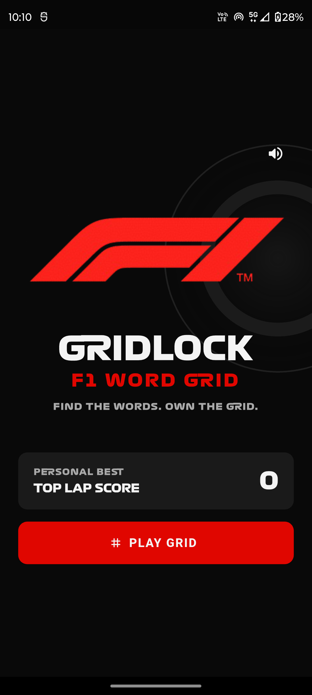
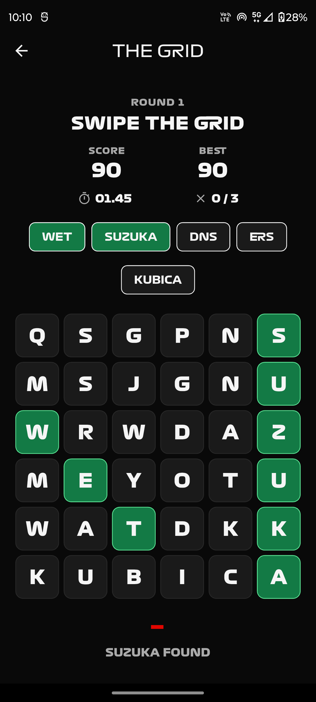
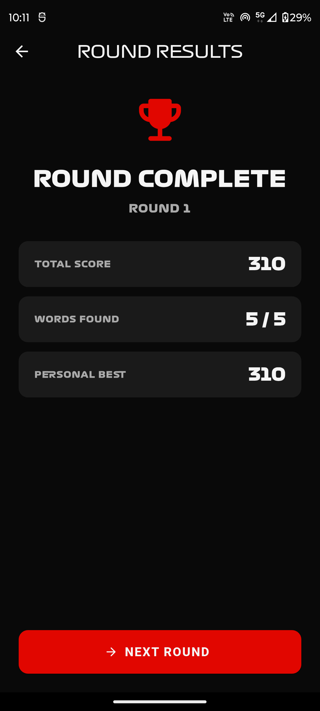
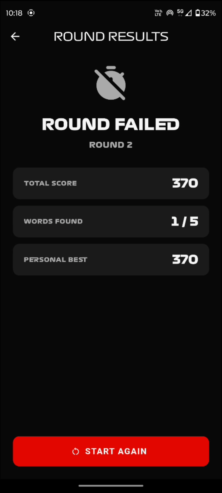

# GRIDLOCK

An offline Formula 1 word-search game for Android, built with Flutter. Find drivers, teams, circuits, and technical terms hidden in the grid before time runs out.

  

  

## Demo

### Screenshots

  
  
  
  

### Gameplay video

[Watch the GRIDLOCK gameplay demo](demo/vid1.mp4)

## Features

- Fully offline
- Find driver names, constructor and manufacturer names, circuits, and motorsport terminology.
- Swipe across horizontal, vertical, or diagonal letters; words can be selected in either direction.
- Endless rounds with increasingly large grids and more target words.
- Countdown timer and limited incorrect swipes, with tougher limits in later rounds.
- Score points for each word and earn a round completion bonus.
- Results screen, cumulative score, and persistent personal best.

## Download Android APK

[Download the latest GRIDLOCK Android APK](https://github.com/ATHER-101/GRIDLOCK/releases/latest/download/GRIDLOCK_v1.apk)
